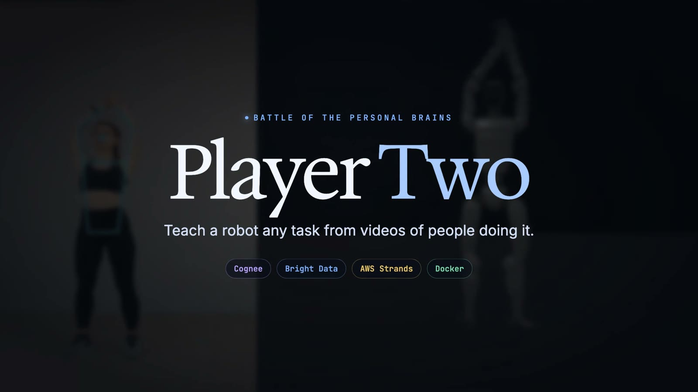
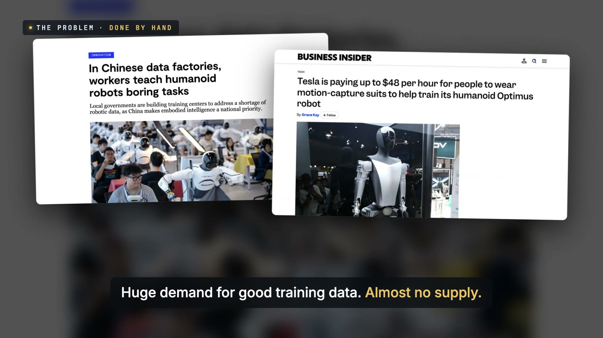
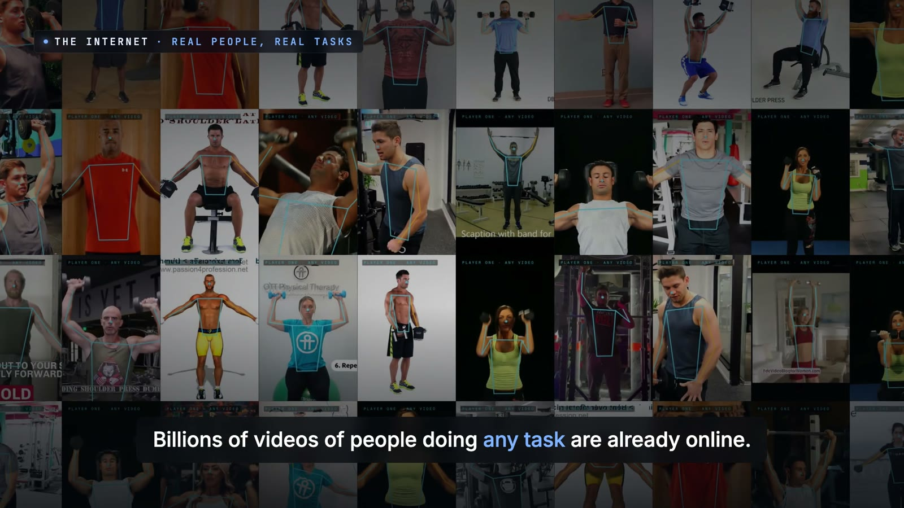
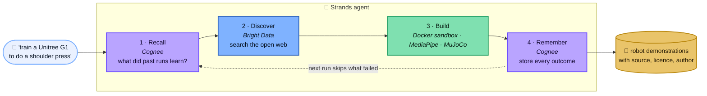
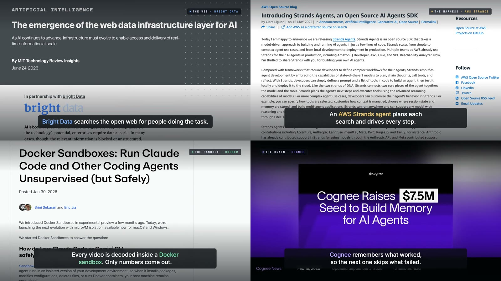
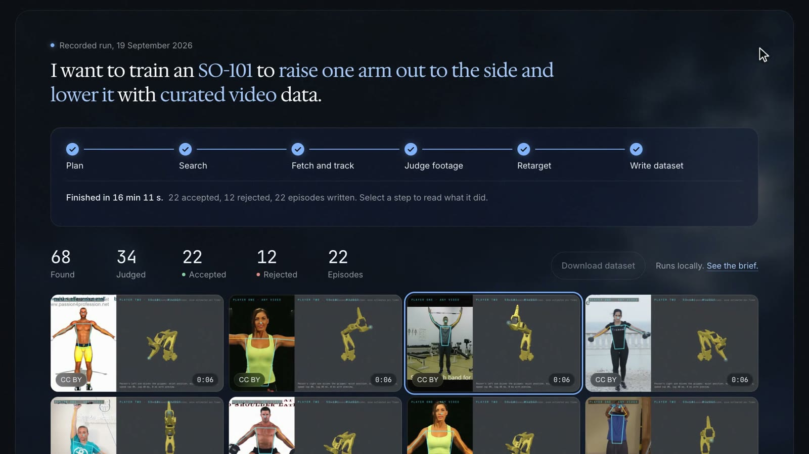
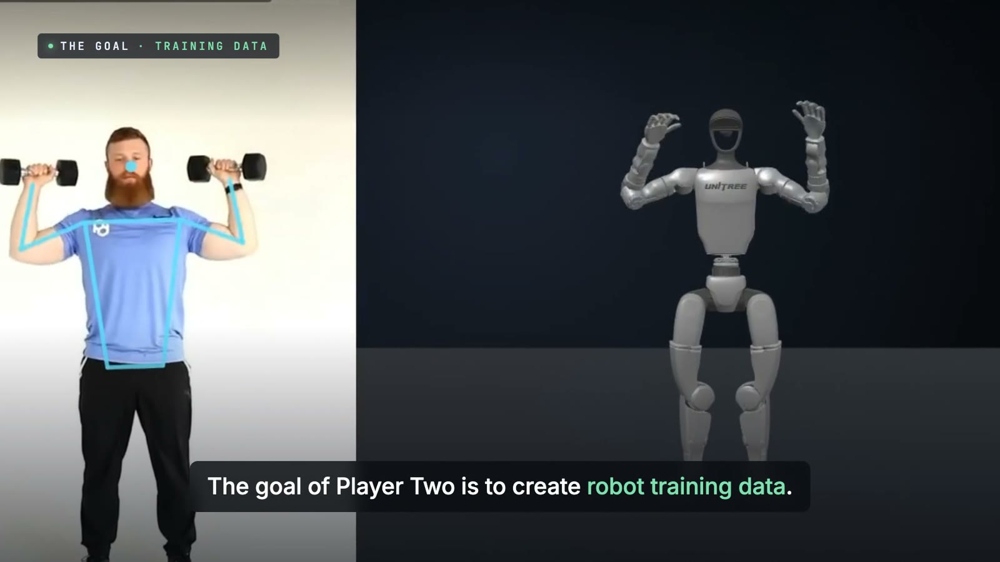

<div align="center">

<a href="docs/brains-demo.mp4"></a>

# 🧠 Player Two

### A brain that teaches robots.

**Type one sentence. Player Two finds videos of real people doing the task, turns their motion into robot training data,<br>and remembers what worked for next time.**

<br>

[](docs/brains-demo.mp4)
[](https://player-two-site.vercel.app)


<sub>Built for <b>Battle of the Personal Brains</b> (Bright Data × Cognee × AWS × Docker), San Francisco, 21 September 2026</sub>

</div>

<br>

## 💡 The problem

Robots learn from demonstrations, and today people record every one of them by hand: data factories full of teleoperators, motion-capture suits, gig platforms. There is huge demand for good robot training data and almost no supply.

Meanwhile TikTok and YouTube already hold billions of videos of people doing every task imaginable. **Player Two turns that footage into robot training data, and gets better at finding it every time it runs.**

<table>
<tr>
<td width="50%"></td>
<td width="50%"></td>
</tr>
<tr>
<td><sub>The problem, in the news: robot data is recorded by hand.</sub></td>
<td><sub>The supply: 40 real people from our accepted clips, all Creative Commons.</sub></td>
</tr>
</table>

<br>

## 🧠 How the brain works

An **AWS Strands agent** drives four tools. It decides what to search for and in what order; the pipeline stays the judge of everything.



| | Tool | What it does in Player Two | Code |
|---|---|---|---|
| 🟧 | **AWS Strands Agents** | The harness. A Strands agent reads what memory recalled, writes the web searches, and calls the four tools in order. If the model is unreachable, the same steps run in a fixed order. | [`brain/agent.py`](brain/agent.py) |
| 🟪 | **Cognee** | The memory. Every video outcome (accepted, rejected and why, or refused) and one lesson per run go into a Cognee knowledge graph. Before the next run, recall pulls them back so downloads that already failed for the same task and robot are skipped. | `recall()` · `remember()` |
| 🟦 | **Bright Data** | The web. SERP searches find videos of people doing the task. Every lead still passes the Creative Commons licence gate and the footage judge. | `discover()` · [`search.ts`](scripts/agent/search.ts) |
| 🟩 | **Docker Sandboxes** | The safety layer. Video from the internet is untrusted input, so it is decoded and pose-tracked inside a Docker sandbox that sees one folder. Only pose numbers come out. | [`fetch.ts`](scripts/agent/fetch.ts) |
| 🟢 | **MediaPipe Pose** | The eyes. It tracks 33 points on the person's body in every frame; that motion drives the robot. | [`extract_pose.py`](scripts/extract_pose.py) |
| 🔵 | **MuJoCo** | The body. Numeric inverse kinematics maps the motion onto a real robot model (Unitree G1, SO-101, Franka Panda) inside physics. | [`src/sim`](src/sim) |



<br>

## 🖥 What it produces

<table>
<tr>
<td width="50%"></td>
<td width="50%"></td>
</tr>
<tr>
<td><sub>A recorded run: 68 videos found, 34 judged, 22 accepted, each clip a real person beside the robot.</sub></td>
<td><sub>MediaPipe tracks the person; the Unitree G1 follows in physics.</sub></td>
</tr>
</table>

Every episode keeps where it came from: source, licence, author, how closely the robot followed, and the judge's score.

<br>

## 🚀 Run it

```bash
pnpm install

# the sandbox that decodes video (Docker Desktop must be running)
docker sandbox create --name p2-pose shell "$PWD/data/sandbox" "$PWD/scripts:ro"

# keys come from the environment (or the macOS keychain), never from a file
export COGNEE_API_KEY=...        # Cognee Cloud
export BRIGHTDATA_API_KEY=...    # Bright Data (SERP zone serp_api1)
export GEMINI_API_KEY=...        # the model behind the Strands agent

# one sentence in, robot demonstrations out
uv run brain/agent.py "dumbbell shoulder press" --robot g1 --sandbox p2-pose --target-accepted 22
```

Each run writes `data/runs/<id>/run.json` (every candidate, verdict and episode), `brain.json` (what the brain did, step by step) and `REPORT.md`. Needs `uv`, `pnpm`, `yt-dlp` and `ffmpeg`. The full technical reference is in [docs/REFERENCE.md](docs/REFERENCE.md).

<br>

## 🧭 Honest status

- **Ran end to end:** the Strands agent driving all four tools, the Docker sandbox (every video in the test runs was decoded inside it), MediaPipe tracking, the footage judge and the MuJoCo retargeting.
- **Built and wired, not yet live:** during the event the Cognee calls were rejected (the API key we had did not authenticate) and the Bright Data account was suspended pending billing, so memory and web discovery did not contribute to the recorded runs. The code paths are complete, and the agent carries on without them rather than failing.
- The output is kinematic demonstrations; no robot policy is trained yet. The gripper cannot close from body pose alone.

<br>

## 📜 Credits

Player Two was first built at [The Executable World hackathon](https://luma.com/exruwpkp) (1st place, Track 1, 19 September 2026; that README is in [docs/EXECUTABLE-WORLD-README.md](docs/EXECUTABLE-WORLD-README.md)). For Battle of the Personal Brains we added the brain: the Strands agent, Cognee memory, Bright Data discovery and the Docker sandbox.

Robot models: Unitree G1 and Franka Panda from MuJoCo Menagerie, SO-101 from TheRobotStudio (licences in `vendor/`). Every source video shown is Creative Commons, with its author and link kept in the run trace. News screenshots in the demo are from their publishers and used for commentary.

<div align="center">
<br>

**Built by [Pranav Achar](https://github.com/PranavAchar01)**

</div>
